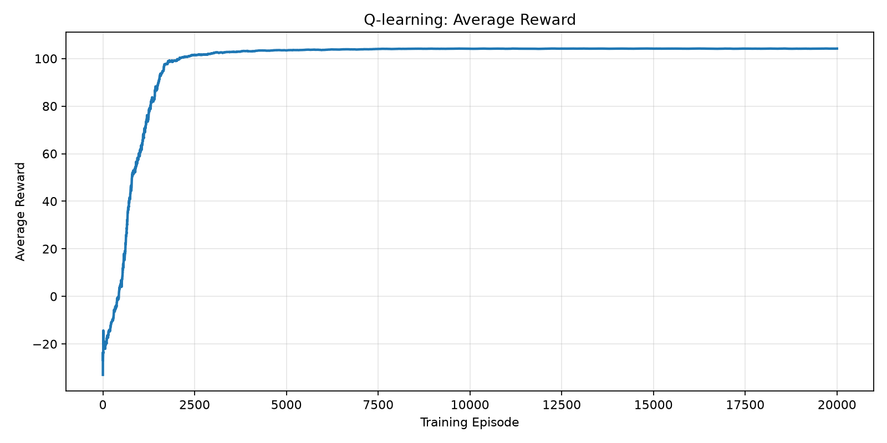
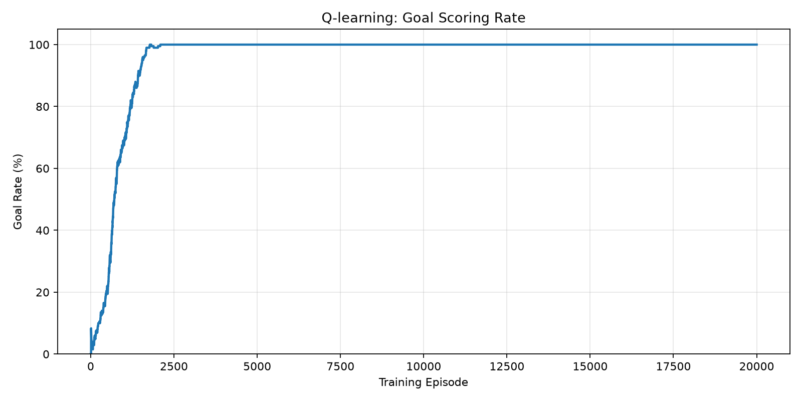
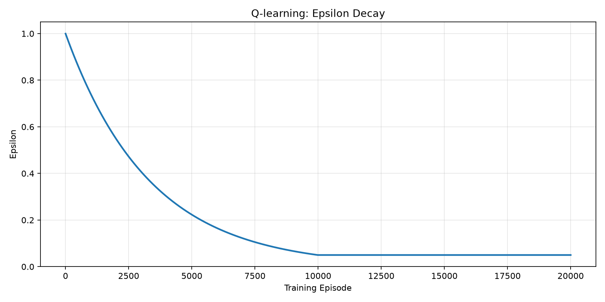

# Football Reinforcement Learning agent project (WIP)

A Reinforcement Learning project exploring how an autonomous agent can learn to play football through trial and error.

The project focuses on implementing and comparing different Reinforcement Learning algorithms, starting with tabular Q-learning and progressing toward Deep Reinforcement Learning methods such as DQN and PPO.

During the first phase of the project I built basic Q_learning agent with Q_table and ε-greedy policy with the following outputs

## Training Results

The Q-learning agent was trained for 20,000 episodes with randomized starting positions.

### Evaluation Results

The trained Q-learning agent was evaluated over 1,000 episodes and compared against a random-action baseline.

| Metric | Q-learning Agent | Random Agent |
|---|---:|---:|
| Goal Rate | 100% | 5.2% |
| Average Reward | 104.29 | -17.04 |
| Average Steps | 7.14 | 59.03 |
| Steps per Goal | 7.14 | 41.31 |

### Average Reward

### Goal-Scoring Rate

### Exploration vs. Exploitation

